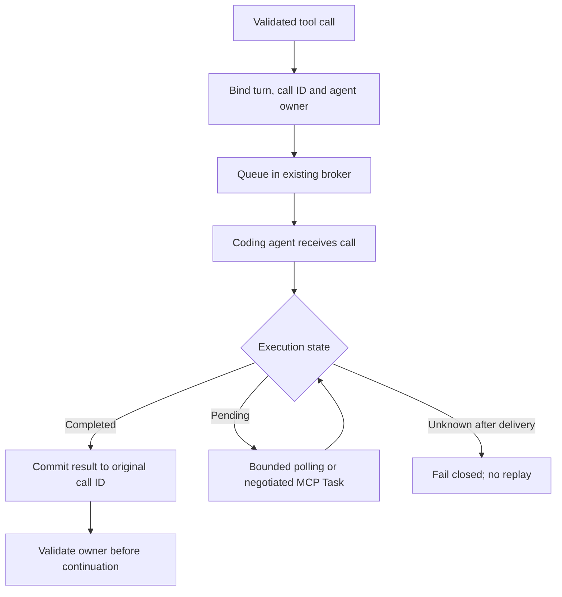

# Async MCP tool lifecycle: architecture decision

**Status:** Engineering Council conditionally accepted the design direction on 2026-10-27; implementation-plan approval and live-client capability verification are outstanding. This is a design record, not evidence of an implemented feature.

**Baseline:** `feat/generic-openai-api-module-20261026` at `de7ba2b5b84eaa043e885915a2afc3a7bb43a027`.

## Problem and outcome

ChatGPT Web invokes the coding agent's advertised tools through the existing MCP bridge. The bridge already permits multiple outstanding asynchronous calls, but a slow call can outlive the original MCP transport. Currently an MCP invocation timeout retires the entire turn binding. The generic Responses adapter separately expires pending tool owners and requires all outstanding tool results in one continuation batch. This can cause `409 Tool continuation has no matching live owner` after valid agent work, and it prevents the model from consuming one completed result while another is still pending.

The desired outcome is **independently progressing tool executions with exact result ownership**, not simply adding `async` keywords. A slow call must not unnecessarily hold up unrelated *execution*. Whether the model can consume its completed sibling's result early is a separate client/continuation capability and cannot be promised by changing the broker alone.

## Existing behavior verified in code

| Component | Existing contract | Evidence |
| --- | --- | --- |
| Turn broker | Tracks per-call promises, queued and delivered IDs, and individual completions | `src/adapters/chatgpt-web/turn-broker.ts`, especially `517-529`, `1250-1290` |
| MCP invocation | Waits up to 90 seconds; timeout/abort releases the **entire** turn binding | `src/adapters/chatgpt-web/mcp-server.ts:47-51`, `607-650` |
| Generic Responses | 80-second pending-owner lease; exact owner/history checks; complete result batch required | `src/integrations/agent-responses/session-manager.ts:69`, `364-380`, `502-575` |
| Missing-owner response | Rejects unmatched function outputs with HTTP 409 | `src/integrations/agent-responses/routes.ts:181-188` |
| Attempt journal | In-process map; no durable cross-restart execution proof | `src/integrations/agent-responses/attempt-journal.ts` |
| Browser host | Five-tab limit, 60-second heartbeat threshold, 30-minute retained-tab TTL | `launcher/electron/browser-host.cjs` |
| Browser helper | Tracks helper/session identity; a retained URL is not a live broker owner | `src/adapters/chatgpt-web/browser-worker.ts` |

The observed 409s must be correlated per request: not every missing owner is necessarily caused by the 80-second expiry.

## Proposed ownership design

Track only the state needed for correctness: original `turnId`/binding, `callId`, authenticated provider account, browser/helper lease, queue/delivery acknowledgement, completion, cancellation and retirement. Scope IDs to the original request and conversation fingerprint; never attach a late result to whichever tab or agent is current.

### Ownership invariants

1. **Queued but never delivered:** may be cancelled individually after an atomic pre-dispatch check. A recorded tombstone blocks late delivery.
2. **Delivered but not positively acknowledged:** execution or filesystem mutation is **unknown**. Preserve fail-closed whole-turn behavior unless stronger protocol evidence proves isolation; never retry writes automatically.
3. **Acknowledged and running:** maintain a bounded active lease and record genuine completion or failure. A lost transport is not proof of failure or success.
4. **Completed:** return the genuine result only to the original `callId` and authenticated conversation owner. Preserve content, errors and multimodal evidence.
5. **Retired:** no new dispatches or cross-owner recovery. Tombstones and immutable diagnostics remain bounded to avoid leaks and unbounded memory.

### Browser ownership

A browser tab can be retained **only** while an authenticated, bounded tool or model-generation lease justifies it. Keep existing heartbeat, cleanup and five-tab resource cap. A stored ChatGPT conversation URL is historical context, not a replacement for a live request ID, broker binding, tool ACK or executed-side-effect proof. Never resurrect an expired MCP RPC by merely reopening that URL.

### Two separate concurrency guarantees

| Guarantee | Design status |
| --- | --- |
| Coding-agent tools A and B execute concurrently; B can finish while A runs | Already supported by broker primitives; test and harden lifecycle |
| ChatGPT model consumes B before A has a result in the **same** generic Responses turn | Currently blocked by all-results-together continuation; requires explicit supported protocol/design change |

## Long-running transport strategy

The MCP bridge's 90-second deadline exists because the upstream tunnel has a roughly two-minute command-response limit. Extending a JavaScript promise or keeping the tab open does **not** extend that original RPC. Preserve bounded `wait_agent` (30-second) and command polling (up to 60-second) paths until verified alternatives exist.

Prefer reuse of existing start/status/poll handles when their contract truly supports a running job. Consider MCP Tasks (`io.modelcontextprotocol/tasks`, `tasks/get`) **only if the actual host negotiates its per-request capability**; never return a task result to a client that did not opt in. The current dependency is `@modelcontextprotocol/sdk` v1, whereas the 2026-07-28 Tasks extension is documented for SDK v2; any SDK migration needs its own compatibility decision.

References: [MCP Tasks specification](https://tasks.extensions.modelcontextprotocol.io/specification/2026-07-28/tasks), [MCP TypeScript SDK v1](https://ts.sdk.modelcontextprotocol.io/), [MCP TypeScript SDK v2](https://ts.sdk.modelcontextprotocol.io/v2/), [OpenAI async tool calling](https://developers.openai.com/api/docs/guides/async-tool-calling).

## Council decision and boundaries

Five independent architecture/implementation/reliability/QA/challenge positions received anonymous peer reviews and a Technical Lead adjudication. A substantive implementation-versus-architecture challenge revised the initial suggestion to isolate every timeout: **per-call retirement is unsafe for delivered-but-unacknowledged operations**. The EDO conditionally approved a staged capability/diagnostics spike and bounded polling; rejected indefinite tab pinning, speculative replay, and promises of unlimited transparent execution on an unchanged client contract.

No user-supplied code or original native-Codex workflow should change unless the existing integration cannot meet an explicitly verified requirement. The bridge is an agent-neutral OpenAI provider, not a client-specific wrapper. No new feature toggle is necessary merely to repair broken ownership semantics.

**Decision gate:** owner approves this design direction; a separate implementation-plan approval and Windows live-client acceptance test are required before calling the feature complete.
